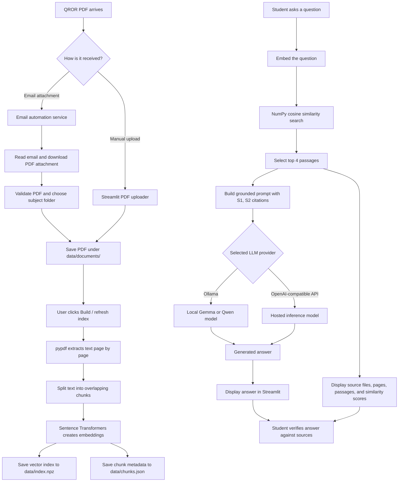

# QROR Research Assistant

A Streamlit retrieval-augmented generation (RAG) assistant for QROR course PDFs. It extracts text from PDFs, embeds chunks with Sentence Transformers, retrieves relevant passages using cosine similarity, and generates answers with source references.

## Features

- Upload PDF files in the sidebar or place permitted PDFs in `data/documents/`.
- Build a local dense-vector index using `sentence-transformers/all-MiniLM-L6-v2`.
- Use Ollama locally, or configure an OpenAI-compatible inference endpoint for a cloud deployment.
- Inspect the retrieved passages and page numbers behind answers.

## Local setup (Ollama)

Use Python 3.11 if possible. Install and start Ollama, then pull the default model:

```powershell
ollama pull gemma4:e2b
```

Create a virtual environment and install dependencies:

```powershell
py -m venv .venv
.\.venv\Scripts\Activate.ps1
python -m pip install --upgrade pip
pip install -r requirements.txt
python -m streamlit run app.py
```

The default configuration is `LLM_PROVIDER=ollama`, `OLLAMA_BASE_URL=http://localhost:11434`, and `OLLAMA_MODEL=gemma4:e2b`.

## Cloud deployment with an OpenAI-compatible inference API

Set these environment variables in the hosting provider's secret/environment settings:

- `LLM_PROVIDER=openai_compatible`
- `INFERENCE_BASE_URL`: provider's OpenAI-compatible base URL, usually ending in `/v1` (or the full `/chat/completions` endpoint)
- `INFERENCE_API_KEY`: secret API key
- `INFERENCE_MODEL`: exact model identifier supported by the provider

Do not commit API keys, OAuth files, or `.env` files. Check the provider's terms, model license, pricing, and data retention before sending course content to it.

For DigitalOcean App Platform, connect the repository, configure a Python web service, and use a run command such as:

```bash
streamlit run app.py --server.address 0.0.0.0 --server.port 8080
```

Configure the service's HTTP port to match. Add the inference variables as encrypted secrets in App Platform. The default App Platform filesystem may be ephemeral: uploaded PDFs and indexes may not survive a redeploy or restart. For a hack-day demo, upload a small, permitted sample PDF and rebuild the index after deployment; for persistent multi-user storage, use object storage and a deliberate index lifecycle.

## How it works

1. Extracts text from PDF pages.
2. Splits page text into overlapping chunks and stores file/page metadata.
3. Embeds chunks with `all-MiniLM-L6-v2`.
4. Retrieves the top four chunks by cosine similarity.
5. Sends the question and retrieved passages to the selected LLM backend and asks it to cite source labels such as `[S1]`.

## End-to-end orchestration



### Why answers contain `[S1]` and `[S2]`

The retrieval step assigns each selected passage a source ID before the prompt is
sent to the model. For example:

```text
[S1] File: Probability/notes.pdf | Page: 3
[S2] File: Probability/lecture.pdf | Page: 7
```

The system prompt then tells the model to cite claims supported by those passages
using `[S1]`, `[S2]`, and so on. This is intentional: the labels connect an answer
back to the retrieved evidence shown in the Streamlit source expander. They are
not additional facts generated by the model.

If you prefer citations to be less prominent, you can change the instruction in
`build_prompts()` in `app.py`, but removing it makes answers harder to verify.

## Limitations and safety

- Scanned PDFs may require OCR. Equations, tables, and multi-column layouts may extract poorly.
- Similarity scores are not probabilities and do not prove that a passage answers a question. Verify important claims against displayed source text.
- This is a prototype, not a secure multi-tenant document platform. Do not upload confidential or restricted course materials to a public demo without permission.
- A hosted inference provider may process prompts and retrieved passages. Review its data policy before use.
- `gmail_importer.py` is a separate future/optional email-ingestion script; it should not contain the Streamlit app.

## License

Add an OSI-approved license before publishing the repository. Also review the model and dependency licenses.
