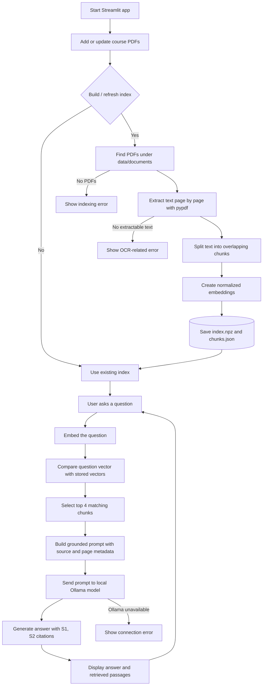

# QROR Research Assistant

A local-first RAG starter project for asking questions about QROR course PDFs. It uses Streamlit for the UI, Sentence Transformers for embeddings, NumPy cosine similarity for retrieval, and Ollama for local answer generation.

## Requirements

- Python 3.11 recommended
- Ollama installed and running
- Enough RAM for the local embedding model and your chosen LLM

## 1. Start the language model

```powershell
ollama pull qwen2.5:3b
ollama run qwen2.5:3b
```

You can exit the interactive chat after confirming the model runs; Ollama's local service should remain available.

## 2. Create a Python environment

From this directory in PowerShell:

```powershell
py -m venv .venv
.\.venv\Scripts\Activate.ps1
python -m pip install --upgrade pip
pip install -r requirements.txt
```

## 3. Add course PDFs

Copy PDFs into `data/documents/`. Subfolders are supported. Text-based PDFs work best; scanned/image-only PDFs need OCR before indexing.

## 4. Run the app

```powershell
python -m streamlit run app.py
```

Open the local URL Streamlit prints in your terminal. Click **Build / refresh index** in the sidebar before asking questions. Rebuild the index whenever you add or replace PDFs.

## How it works

1. Extracts text page by page from PDFs.
2. Splits each page into overlapping chunks while preserving file and page metadata.
3. Embeds chunks with `sentence-transformers/all-MiniLM-L6-v2`.
4. Retrieves the four most similar chunks using cosine similarity.
5. Sends the question and retrieved passages to Ollama, asking the model to cite sources as `[S1]`, `[S2]`, etc.

### Workflow diagram



The index is the bridge between the two paths: `index.npz` stores the embedding vectors, while `chunks.json` stores the matching text and its PDF/page metadata. The answer path does not search the PDFs again; it searches the saved vectors and then passes the selected passages to Ollama.

## Current limitations

- Retrieval is a simple dense-vector baseline; no reranker or hybrid keyword search yet.
- PDF extraction may struggle with equations, tables, multi-column layouts, and scanned pages.
- Similarity scores are not probabilities or proof that a passage answers the question.
- Citations are model-generated labels tied to retrieved passages, so verify important claims against the displayed source text and page.
- The first run downloads the embedding model. Ollama downloads its LLM separately.
